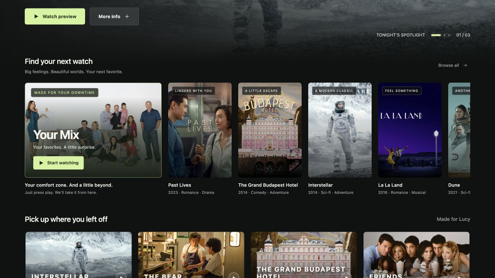

# Streaming Platform — Your Mix

### Less deciding. More discovering.

A product design and interactive prototyping project by **Lucy Zhang**, exploring how a streaming platform can help viewers move from “What should I watch?” to a confident choice.

**[▶ Try the live demo](https://princess-gan.github.io/streaming-platform-your-mix/)** · [Explore the experience](#the-experience) · [Product decisions](#product-decisions) · [Validation plan](#what-i-would-test-next)

[](https://princess-gan.github.io/streaming-platform-your-mix/)

| Role | Work | Status |
| --- | --- | --- |
| Independent product designer & prototype builder | Problem framing, experience design, interaction iteration, AI-assisted implementation | Live interactive prototype; illustrative recommendations |

## The vision

Make discovering something to watch feel like being guided by someone who knows your taste: start with what feels familiar, then gently introduce something new.

Your Mix is a proposed curation experience inside a streaming platform. It brings familiar shows, timely suggestions, nostalgic favorites, friends' discoveries, and trending titles into a continuous preview session. The goal is to help viewers find a satisfying full-length watch—not simply spend longer scrolling through previews.

## The product insight

My starting hypothesis: **recommendation relevance and the effort of choosing are different product problems.** A homepage can surface appealing titles while still asking viewers to compare posters, open detail pages, and commit before they have felt a scene.

I took inspiration from Spotify DJ's guided changes of context and the low effort of sampling short-form video. For streaming, the opportunity is to use short previews as a bridge into a film or episode, while keeping the viewer in control.

The concept grew from a self-initiated demo I presented to my team during my time at PwC. I revisited it as an independent portfolio prototype. This repository is a personal reconstruction, not a PwC client deliverable or an affiliated streaming service.

## The experience

**Home → Your Mix → Familiar favorites → New contexts → Choose a title**

1. **Enter from the homepage.** Your Mix appears in the discovery section above the continue-watching shelf, with a familiar Modern Family cover and one clear entry action.
2. **Start watching without a questionnaire.** A brief cover leads into a muted embedded preview. Viewers can pause or move on; host voice is optional and off by default.
3. **Understand why it is here.** Each title gets a clear category heading and one short explanation, with important context such as a friend's name emphasized.
4. **Move between contexts.** Short category transitions connect the sequence. Each preview has a 45-second playing-time budget; loading and buffering may add time.
5. **Choose the full-length experience.** Equal-sized primary and Next buttons make the decision clear. Resume episode, Watch movie, and Watch series distinguish choosing a title from watching its preview.

| Recommendation context | Viewer need explored | Example |
| --- | --- | --- |
| Continue watching | Return to something already enjoyed | Modern Family, Friends |
| Friday evening | Find something that fits the moment | Before Sunrise, La La Land |
| Nostalgia | Reconnect with a favorite | The Avengers, Spider-Verse |
| Friends | Discover through a familiar social connection | Past Lives, The Bear |
| Trending / new to the library | Explore beyond established favorites | Dune, Soul |

## Product decisions

| Decision | Reasoning and tradeoff |
| --- | --- |
| Remove mood selection before entry | Let viewers sample value before asking them to articulate preferences. Initial relevance would need to be tested. |
| Explain the recommendation in one line | Clarify the context without competing with the video. Removed word clouds that added visual noise. |
| Make category headings prominent | Help viewers recognize a meaningful sequence instead of an unrelated playlist. |
| Default voice off and video muted | Support a quiet, low-friction entry while preserving optional sound controls. |
| Separate preview controls from title selection | Reduce ambiguity between pausing a clip and choosing the full episode. |
| Put discovery above the resume shelf | Increase visibility for the new experience; test whether this slows viewers who arrived to resume a show. |

## What this project demonstrates

- **Product judgment:** reframing the opportunity around decision effort and viewing intent, beyond recommendation accuracy alone.
- **Interaction design:** translating an abstract curator concept into concrete entry, preview, transition, pause, skip, and title-selection states.
- **Prioritization:** removing competing controls and explanatory clutter so each screen has a clear purpose.
- **Execution:** using AI-assisted HTML, CSS, and JavaScript development to turn the concept into a deployed, inspectable prototype with real embedded media.
- **Experimental thinking:** separating product hypotheses from measured outcomes and identifying what would need validation before scaling.

## What I would test next

These are proposed tests, not completed research or reported results.

First, run moderated usability sessions to learn whether viewers understand each recommendation, distinguish preview playback from title selection, and can find pause and Next without explanation. Then compare the existing browse experience with Your Mix in an instrumented pilot.

**Primary outcome:** time from discovery entry to a satisfying full-title choice. In this prototype, title selection is only a proxy; a production test would also measure actual playback and viewing satisfaction.

**Supporting measures:** preview-to-title selection rate, discovery abandonment, perceived decision effort, and discovery outside familiar titles.

**Guardrails:** time to resume an existing show, accidental selections, unwanted autoplay/audio, spoiler complaints, accessibility, and satisfaction after playback. Preview watch time alone would not define success.

## Scope and implementation

The current version contains **10 preview slots across five recommendation contexts**. It uses scripted sequencing and sample history, friend activity, and trend labels. There is no live recommendation model, LLM agent, social graph, or production behavioral dataset behind these examples. A future AI curator would require permissioned signals, grounded explanations, and evaluation of recommendation quality.

Official YouTube clips and trailers are embedded through the IFrame API. Full-episode playback is a simulated handoff, not an integrated streaming service. Clips may show ads or vary in availability by region; they do not reproduce a real user's saved episode position. Film artwork and videos belong to their respective rights holders.

**Stack:** HTML · CSS · JavaScript · YouTube IFrame API · GitHub Pages

```sh
python3 -m http.server 4173
```

Open `http://localhost:4173` to run locally. GitHub Pages publishes the repository root from `main`.

---

**中文简介**：Your Mix 是一个流媒体内容发现原型，探索如何通过自动片段预览、清晰的推荐理由和连贯的场景切换，降低用户“决定看什么”的负担。项目体现了从问题定义、产品取舍到交互迭代与 AI 辅助开发的实践；目前推荐数据为演示设定，效果仍需用户研究和实验验证。
